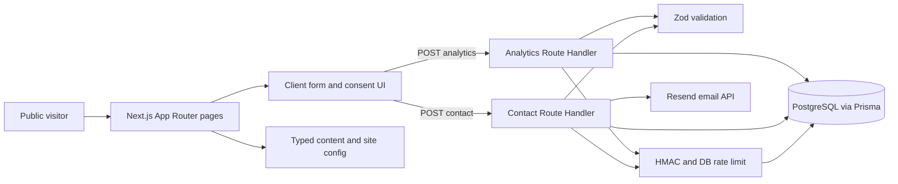

# Architecture

## Runtime and boundaries

`package.json` pins Next.js **16.4.2**, React 19.3.0, and the App Router in root `app/`; the project uses strict TypeScript and Tailwind CSS 4 (`app/globals.css`). `app/layout.tsx` supplies fonts, navigation, footer, metadata, JSON-LD, palette CSS, scroll UI, and the analytics-consent component. `app/template.tsx` wraps route changes. Most route pages are Server Components; interactive form, filters, navigation, consent, scroll effects, and WebGL visuals are Client Components marked `"use client"`.

The service and work detail pages use `generateStaticParams` and `dynamicParams = false`. `/contact` awaits `searchParams` and validates the optional service slug. Jobs listing and detail pages render dynamically from PostgreSQL. There are no Server Actions, proxy/middleware, queues, or explicit server-side cache layer. Scheduled jobs depend on an external cron call, not an in-process timer.

## Module map

The jobs extension adds `lib/jobs/` for validated provider adapters, queries, and synchronization; `lib/admin-auth.ts` for database-backed sessions; `app/jobs/` for server-rendered discovery and details; `app/admin/` for a URL-only operations page; and jobs/admin/internal Route Handlers. Prisma remains the sole ORM. Manual sync creates a queued database run. The external scheduler calls a secret-protected route that handles one queued or due run; there is no in-process timer. Processing occurs within that request and relies on a database unique partial index to reject overlap.

| Module | Responsibility |
| --- | --- |
| `app/`, `components/` | Public routes and shared UI; `components/hero-visual.tsx` loads a WebGL scene only in the browser with a static/reduced-motion fallback. |
| `config/site.ts`, `config/palette.ts` | Public site config, metadata defaults, navigation, and CSS/visual colors. |
| `data/services.ts`, `data/portfolio.ts` | Typed, code-owned marketing content. Portfolio data is illustrative. |
| `lib/seo.ts` | Page metadata and structured-data helpers. |
| `lib/validation.ts` | Zod request schemas and accepted service slugs. |
| `app/api/contact/route.ts`, `app/api/analytics/route.ts` | Public Node.js POST handlers. |
| `lib/db.ts`, `lib/email.ts`, `lib/security.ts` | Server-only Prisma/PostgreSQL access, Resend notifications, HMAC and rate-limit helpers. |
| `prisma/` | Lead, analytics, abuse, jobs, and admin models with initial and jobs migrations. |

## Data flow

The contact page optionally preselects a service, and `ContactForm` posts JSON. The handler checks configuration and request shape, validates with Zod, checks honeypot/bot and rate limits, inserts a `Lead`, sends a Resend notification, then marks `notificationSent` and returns `{ "ok": true }`. If email delivery fails, the lead remains stored with `notificationSent = false` and the endpoint returns an error. This is a two-step process, not an atomic database/email transaction.

The consent banner stores an allow/deny choice in `localStorage`. On allow, client code maintains a random visitor ID in `localStorage` and a session ID in `sessionStorage` (renewed after 30 minutes of inactivity), then sends coarse events. The handler verifies payload shape, rate-limits by a pseudonymized forwarded IP, HMACs the visitor/session IDs, and stores `AnalyticsEvent`. Repeated `eventId` values are ignored through a unique database key. There is no authenticated read endpoint. See [API](API.md), [database](DATABASE.md), and [security](SECURITY.md) for limits.

## Errors and operations

The original contact and analytics handlers return generic client errors and call `console.error` for processing failures. Jobs has a route-level error boundary and loading UI. There is no structured tracing, health endpoint, or monitoring configuration. Security headers are configured in `next.config.ts`. Production operation and provider availability have not been verified.
