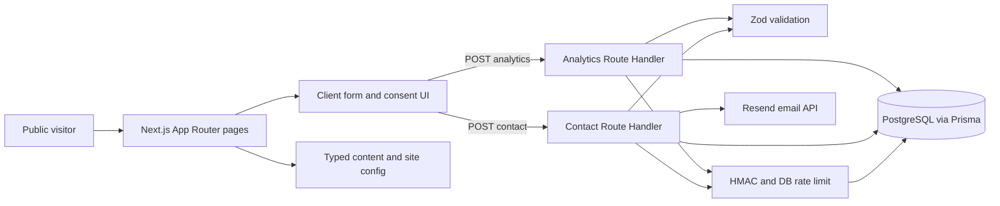

# Architecture

## Runtime and boundaries

`package.json` pins Next.js **16.4.2**, React 19.3.0, and the App Router in root `app/`; the project uses strict TypeScript and Tailwind CSS 4 (`app/globals.css`). `app/layout.tsx` supplies fonts, navigation, footer, metadata, JSON-LD, palette CSS, scroll UI, and the analytics-consent component. `app/template.tsx` wraps route changes. Most route pages are Server Components; interactive form, filters, navigation, consent, scroll effects, and WebGL visuals are Client Components marked `"use client"`.

The service and work detail pages use `generateStaticParams` and `dynamicParams = false`. `/contact` awaits `searchParams` and validates the optional service slug. `/blog` lists published articles, and the AI agents editorial route is a static server-rendered article with shared page metadata and inclusion in the sitemap. Article body text does not use the shared scroll-reveal animation. The jobs listing loads through the public jobs API with browser-held filters and pagination; job details render dynamically from PostgreSQL. There are no Server Actions, proxy/middleware, queues, or explicit server-side cache layer. Scheduled jobs depend on an external cron call, not an in-process timer.

## Directory structure and module map

The repository keeps Next.js routes and special files under `app/`, while feature-owned UI and logic live in `features/`. Shared components and cross-feature helpers remain outside feature folders. The `@/*` TypeScript alias maps to the repository root.

```text
app/                         # App Router pages, layouts, metadata, styles, and Route Handlers
components/
  effects/                   # Shared scroll, reveal, and pointer effects
  home/                      # Homepage-specific sections and WebGL visuals
  layout/                    # Site header and footer
  shared/                    # Reusable page hero, JSON-LD, service icon, and work filter
features/
  analytics/components/      # Analytics consent UI
  contact/components/        # Contact form UI
  jobs/
    components/              # Jobs search and admin/provider UI
    server/                  # Jobs logic, provider adapters, queries, sync, and admin auth
config/                      # Site metadata/navigation and palette configuration
data/                        # Typed, code-owned service and illustrative portfolio content
lib/                         # Shared database, email, security, SEO, validation, and JSON helpers
prisma/                      # Prisma schema and committed migrations
public/                      # Static assets
scripts/                     # Operational scripts
tests/                       # Centralized Vitest tests
docs/                        # Product, API, architecture, security, database, and deployment guides
```

Place feature-specific UI with its owning feature; use `components/shared/` only for UI reused across unrelated features. Put jobs-domain code in `features/jobs/`, and keep shared integrations and helpers in `lib/`. New route entry points stay in their framework-required `app/` locations and delegate feature behavior to feature modules. Tests stay in `tests/` to match the centralized test convention. Client Components remain marked `"use client"`; modules that import `server-only` must not be imported by client code.

The jobs feature contains validated provider adapters, queries, synchronization, and database-backed admin sessions; `app/(studio)/jobs/` renders discovery and details. Under `app/(studio)/admin/`, the login page is separate from a protected route group: `/admin` is the workspace overview and `/admin/jobs` owns provider, schedule, and sync controls. The admin area intentionally uses a separate operations visual system from the public landing pages, with a stationary sidebar, a separately scrolling content pane, dashboard health/metric panels, and custom listbox-style selectors for admin forms. Each page checks the database-backed session before reading admin data. `app/api/` retains the jobs/admin/internal Route Handlers with their own authorization. Provider description HTML is decoded and converted to structured plain text before storage; the detail page renders headings, paragraphs, and lists as React elements. Prisma remains the sole ORM. `scripts/seed-job-providers.mjs` configures four real public feeds on a new database without overwriting existing provider rows. Sync reads existing job hashes in batches, upserts normalized rows, and marks missing jobs expired after the configured grace period. Manual sync processes during the authenticated admin request. The external scheduler calls a secret-protected route for due runs or older queued runs; there is no in-process timer. Processing occurs within that request and relies on a database unique partial index to reject overlap.

| Module | Responsibility |
| --- | --- |
| `app/`, `components/`, `features/` | Public routes, shared UI, and feature-owned UI; the homepage retains its original client-loaded WebGL particle-logo hero with static/reduced-motion fallback, reusable concept title studies, and a client business-priority selector that links into the existing service/contact routes. |
| `config/site.ts`, `config/palette.ts` | Public site config, metadata defaults, navigation, and CSS/visual colors. |
| `data/services.ts`, `data/portfolio.ts` | Typed, code-owned marketing content. Portfolio data is illustrative. |
| `lib/seo.ts` | Page metadata and structured-data helpers. |
| `lib/validation.ts` | Zod request schemas and accepted service slugs. |
| `app/api/contact/route.ts`, `app/api/analytics/route.ts` | Public Node.js POST handlers; feature UI is under `features/contact/` and `features/analytics/`. |
| `features/jobs/server/` | Jobs domain logic, provider adapters, queries, synchronization, and admin sessions. |
| `lib/db.ts`, `lib/email.ts`, `lib/security.ts` | Server-only Prisma/PostgreSQL access, Resend notifications, HMAC and rate-limit helpers. |
| `prisma/` | Lead, analytics, abuse, jobs, and admin models with initial and jobs migrations. |



## Data flow

The contact page optionally preselects a service, and `ContactForm` posts JSON. The handler checks configuration and request shape, validates with Zod, checks honeypot/bot and rate limits, inserts a `Lead`, sends a Resend notification, then marks `notificationSent` and returns `{ "ok": true }`. If email delivery fails, the lead remains stored with `notificationSent = false` and the endpoint returns an error. This is a two-step process, not an atomic database/email transaction.

The consent banner stores an allow/deny choice in `localStorage`. On allow, client code maintains a random visitor ID in `localStorage` and a session ID in `sessionStorage` (renewed after 30 minutes of inactivity), then sends coarse events. The handler verifies payload shape, rate-limits by a pseudonymized forwarded IP, HMACs the visitor/session IDs, and stores `AnalyticsEvent`. Repeated `eventId` values are ignored through a unique database key. There is no authenticated read endpoint. See [API](API.md), [database](DATABASE.md), and [security](SECURITY.md) for limits.

## Errors and operations

The original contact and analytics handlers return generic client errors and call `console.error` for processing failures. Jobs has a route-level error boundary and loading UI. There is no structured tracing, health endpoint, or monitoring configuration. Security headers are configured in `next.config.ts`. The first local production-server import and public reads were verified against Neon; deployed scheduling and ongoing provider availability remain unverified.

## Public design system

The homepage Process section uses its own `.process-layout` composition with one ordered list of explained stages, rather than mounting the compact `HeroAside` Process variant.

`HeroAside` supplies page-specific visual panels through the optional `PageHero.visual` prop, the jobs hero and the homepage Process section. Its links use existing routes or section anchors. CSS handles responsive stacking and reduced-motion-aware entrances; panels are excluded from generic reveal observation. Jobs keeps a static hero panel and its existing simpler content motion.

See [DESIGN.md](../DESIGN.md) for public visual rules. Palette tokens live in `config/palette.ts`, shared utility compositions in `config/styles.ts`, and the incremental public redesign layer in `app/redesign.css` after the existing theme/jobs styles. `ConceptArtwork` is shared by the homepage, filtered work list and concept details; `ProjectStartingPoint` uses the existing typed service data. The older `ScrollStory` component remains available but is not mounted. Public details use one-time full side entrances, with static/reduced-motion/print visibility. No API, schema, authentication, or provider behavior changed.

Public content entrances are classified by content type in `components/effects/reveal.tsx`; its observer also handles newly mounted portfolio/job results after navigation or filtering. CSS uses individual translate/scale properties, viewport-relative side distances measured before animation, and bounded stagger delays. Only JS-prepared pending items are hidden; reduced-motion and print CSS expose all content. Horizontal clipping on main preserves the story's sticky layout. Each unit runs once, excludes nested units and admin/hero scenes, and cancels on focus or reduced-motion changes.

Jobs pages scope the shared reveal CSS to a 200ms vertical settle of 6px via their existing `.jobs-hero` marker. The exception also applies to their shared footer and keeps pending results visible; it does not alter jobs fetching, filters or pagination.

## Grouped jobs discovery

Source rows retain `(sourceProviderId, externalJobId)` uniqueness and their original slugs. A database-maintained `listingKey` groups matching company/title/location values, allowing different requisitions to remain stored while public discovery shows one matching card. `features/jobs/server/queries.ts` uses parameterized SQL to filter before grouping, choose a deterministic representative, and paginate/count unique groups; it hydrates only the selected public fields with Prisma. Detail routes preserve every original source slug. The database trigger maintains keys automatically during existing sync upserts, so no feed data is discarded and no new management endpoint is introduced.

## Anonymous developer toolbox

`proxy.ts` matches the exact `utility.futurvion.in` or development `utility.localhost` Host value. It rewrites only `/`, `/privacy`, and `/tools/<slug>` to `app/toolbox-internal/`; metadata discovery responses are host-specific. Direct access to the internal namespace is denied on every host. Utility requests to studio routes, APIs, and admin return 404 before application execution. Other hosts keep normal routing. Incoming forwarded-host headers never grant a toolbox exception.

The root layout owns fonts, global CSS, and base metadata. Existing page routes and their original template are under the URL-neutral `(studio)` route group, whose layout retains the public header/footer, organization data, reveal effects, and analytics consent. Existing protected admin layouts and page checks moved unchanged. The toolbox layout mounts none of these analytics/effect components. Original public static rendering remains available.

`features/toolbox/` owns the typed directory, metadata helpers, shared shell, interactive workspace, and pure transformations. `public/toolbox-regex-worker.js` isolates user regular expressions; the UI terminates execution after 750 ms and caps input and matches. There are no tool APIs, server actions, database imports, persistence, or third-party processing. Workspaces reset on navigation/remount and page lifecycle events. A disabled `AdSlot` returns null and loads no scripts. Owned products in `data/portfolio.ts` are rendered separately from illustrative concepts through the existing Works grid and styles.

For plain-localhost development, `npm run dev:tools` reserves port 3001. Proxy recognizes exact loopback host-and-port pairs only when `NODE_ENV` is development; production requests to localhost never enable that exception. The normal development command still serves the studio on port 3000.
